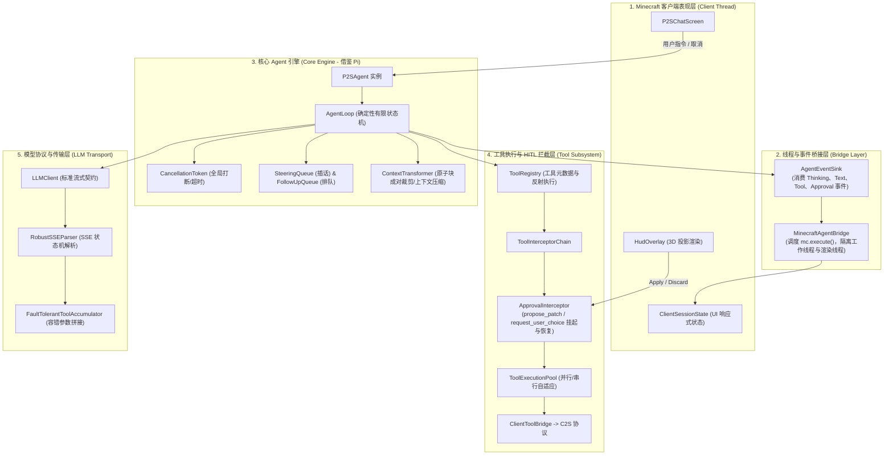

# P2S Workspace: Agent 核心架构重构设计方案（借鉴 Pi Agent 核心规范）

> **2026-11-25 更新**：本提案经评审后按修订方案实施，审批、参数修复和迁移顺序与下文不同。实际结构与各批次记录以 `docs/architecture/agent-runtime-migration.md` 为准。

> **项目**：`fabric-prompt2structure-mod-1.21` (Minecraft Fabric 1.21.x, Java 21)  
> **文档定位**：技术架构演进方案 (Technical Architecture Proposal & Review Draft)  
> **状态**：待评审 (Draft for Review)  

---

## 1. 背景与重构动因

P2S Workspace 是一个运行在 Minecraft 客户端进程内部的 AI 辅助建筑工作区模组，其核心机制是通过大语言模型（LLM）执行代码级规划、技能检索（Skill System）、子智能体派发（Subagents）以及世界结构补丁（Structure Patch Engine）的生成与应用。

当前模组的 Agent 体系完全由 Java 21 手写实现（主要分布在 `ClientAgentManager.java`、`LLMService.java`、`SubagentManager.java` 等）。经过生产实践与对比成熟的开源 Agent 框架（如 `@mariozechner/pi-agent-core`），现存架构暴露了较多的技术债与隐患。

本方案旨在**保持 Pure Java 21（零外部 Node.js 进程依赖，维持单一 JAR 开箱即用）的前提下，系统性吸收 Pi Agent 核心的设计思想**，重构出一个事件驱动、健壮容错、支持随时打断与优雅人机协同（HITL）的高性能 Agent 核心。

---

## 2. 现存架构缺陷诊断 (Diagnosis & Technical Debts)

### 2.1 缺少主动打断 (Abort) 与消息排队机制
* **现象**：Agent 执行中，用户在聊天面板输入任何新消息，直接被 `if (session.inFlight) return;` 拒绝丢弃，UI 弹出 `busy`。
* **根因**：只有粗暴的全局布尔锁 `inFlight`，底层 OkHttp 调用与工具调度链未接入协作式取消令牌（`CancellationToken`）。用户无法随时按 Esc 停止失控循环，也无法向运行中的 Agent 插入补充指令（Steering）。

### 2.2 脆弱的手撕流式协议与 Tool Call 拼接器
* **现象**：`LLMService.java` 中手写 `readSSEStream` 逐行扫描 `data: `，依靠 `ToolCallAccumulator` 拼接分片 JSON。
* **根因**：
  1. 遇到网络波动、畸形 chunk 或未闭合括号时，Gson 解析直接崩溃，导致整轮会话中断。
  2. 缺乏对现代模型 Thinking Token（DeepSeek-R1 `reasoning_content`、Claude `thinking`）的原生分流解析，思考过程混入普通文本或直接丢失。
  3. 彻底硬编码绑定于 OpenAI Chat Completions 协议，无法平滑扩展。

### 2.3 人机协同审批 (HITL) 硬编码侵入主循环
* **现象**：`ClientAgentManager.java` 主循环底部硬编码检查 `if (ClientSessionState.hasPendingPatch()) return false;`。
* **根因**：`propose_patch`（3D 方块预览与审批）和 `request_user_choice`（选项菜单）直接耦合了 Minecraft 客户端 UI 状态机，破坏了 AgentLoop 的纯粹性与可重用性。

### 2.4 上下文截断算法存在孤儿 Tool 破坏风险
* **现象**：调用 OpenAI 接口偶尔出现 `Invalid message order: Tool call id mismatch (HTTP 400)`。
* **根因**：`MAX_HISTORY = 40` 的轮数截断与 `ClientHistoryCompactor` 未将 `assistant.tool_calls` 与紧随其后的 `tool` 结果视为不可分割的“原子块 (Atom Chunk)”。截断一旦发生在两类消息之间，便会产生孤立的 Tool 消息，被上游服务判为协议非法。

### 2.5 复杂多线程竞争与静态全局锁
* **现象**：并发下容易出现状态串台、Session 切换时旧回调写入新历史。
* **根因**：内部混杂了 4 个 Java `ExecutorService` 线程池与 Minecraft 渲染主线程，核心状态完全依赖全局类锁 `synchronized (LOCK)` 与静态单例，非面向对象的实例模型。

### 2.6 Subagent 轮询模式浪费预算
* **现象**：主 Agent 派发子任务后，必须在后续 Turn 中反复调用 `get_subagent` 轮询子任务状态。
* **根因**：缺乏事件唤醒与回调链路，既空耗安全循环次数（`SAFETY_LOOP_LIMIT`），又浪费 API Token。

---

## 3. 重构设计原则 (Design Principles)

1. **Pure Java 21 & 零外部依赖**：彻底留在 Minecraft JVM 内，不引入本地 Node.js/Python 进程。
2. **实例优先，摒弃静态单例**：每个会话拥有独立的 `P2SAgent` 实例，杜绝并发串台。
3. **单向事件流 (Event-Driven)**：Agent 核心只负责计算与发射不可变事件（`AgentEvent`），UI 仅作为观察者消费事件。
4. **协作式取消与双队列体系**：标准 `CancellationToken` + 插话队列（`SteeringQueue`）+ 排队队列（`FollowUpQueue`）。
5. **拦截器统一人机审批 (HITL via Interceptor)**：借鉴 Pi 的 `beforeToolCall / afterToolCall`，将审批挂起转化为标准的 Future 延期兑现。
6. **原子块成对修剪**：上下文管道保证 `assistant(tool_calls)` 与 `tool` 响应强配对。

---

## 4. 目标架构全景 (Target Architecture)



---

## 5. 核心接口与数据契约设计

### 5.1 事件定义 (AgentEvent)
```java
package com.p2s.agent.event;

import com.google.gson.JsonObject;

public sealed interface AgentEvent {
    // 思考过程流式分片（适配 DeepSeek-R1, Claude 3.7）
    record ThinkingDelta(String delta) implements AgentEvent {}

    // 正文文本流式分片
    record TextDelta(String token) implements AgentEvent {}

    // 工具调用生命周期
    record ToolCallStarted(String toolCallId, String name, JsonObject args) implements AgentEvent {}
    record ToolCallFinished(String toolCallId, String name, JsonObject result, boolean isError) implements AgentEvent {}

    // 人机协同审批挂起事件
    record ApprovalRequired(String approvalId, ApprovalType type, JsonObject payload) implements AgentEvent {}

    // 会话轮次完成
    record TurnCompleted(TurnStatus status) implements AgentEvent {}

    // 错误捕获
    record ExecutionError(String message, Throwable cause, boolean recoverable) implements AgentEvent {}
}
```

### 5.2 协作式取消令牌 (CancellationToken)
```java
package com.p2s.agent.runtime;

import java.util.concurrent.CopyOnWriteArrayList;
import java.util.concurrent.atomic.AtomicBoolean;

public final class CancellationToken {
    private final AtomicBoolean cancelled = new AtomicBoolean(false);
    private final CopyOnWriteArrayList<Runnable> onCancelCallbacks = new CopyOnWriteArrayList<>();

    public boolean isCancelled() {
        return cancelled.get();
    }

    public void cancel() {
        if (cancelled.compareAndSet(false, true)) {
            for (Runnable callback : onCancelCallbacks) {
                try {
                    callback.run();
                } catch (Exception ignored) {}
            }
        }
    }

    public void register(Runnable onCancel) {
        if (isCancelled()) {
            onCancel.run();
        } else {
            onCancelCallbacks.add(onCancel);
        }
    }

    public void throwIfCancelled() throws InterruptedException {
        if (isCancelled()) {
            throw new InterruptedException("Agent execution was cancelled by user.");
        }
    }
}
```

### 5.3 HITL 工具拦截器 (ToolInterceptor)
```java
package com.p2s.agent.tool;

import com.google.gson.JsonObject;
import java.util.concurrent.CompletableFuture;

public interface ToolInterceptor {
    CompletableFuture<ToolResult> intercept(ToolInvocationContext context, ToolExecutionChain chain);
}
```
* **审批拦截器核心机制 (`ApprovalInterceptor`)**：
  当调用 `propose_patch` 时，拦截器不执行底层写入，而是生成一个 `approvalId`，构造尚未完成的 `CompletableFuture<ToolResult>`，并将该 Future 暂存在全局待审批索引中；随后发射 `ApprovalRequired` 事件。当用户在游戏屏幕中点击 Apply/Discard 时，UI 线程调用 `resolve(approvalId, result)` 完成 Future，主 Agent 状态机立即自然唤醒。

### 5.4 上下文成对修剪规则 (`ContextTransformer`)
```java
package com.p2s.agent.context;

import com.google.gson.JsonObject;
import java.util.List;

public final class ContextTransformer {
    /**
     * 安全截断历史消息，保证任何包含 tool_calls 的 assistant 消息
     * 与其后对应的所有 tool 响应作为一个原子不可分割块 (Atom Chunk)。
     */
    public static List<JsonObject> pruneSafely(List<JsonObject> history, int maxBudgetTokens) {
        // 1. 构建原子块索引（将 assistant(with tool_calls) + 随后的 N 个 tool 消息聚合成单一 Chunk）
        // 2. 从后向前累计 Token 预算
        // 3. 超出预算时按整块淘汰，杜绝孤立 tool 消息留在头部
        return history;
    }
}
```

---

## 6. 分阶段演进与重构路线图 (Implementation Plan)

为确保模组在改造过程中保持可构建、可运行，不破坏既有游戏功能，推荐按以下 4 个阶段渐进推进：

### 阶段 1：LLMService 传输协议与容错加固
* **目标**：不改动上层调度，优先解决流式断流、畸形 JSON 与 Thinking Token 支持。
* **任务**：
  1. 重写 `readSSEStream` 为标准状态机，兼容不同厂商换行符与注释块。
  2. 提取 `ThinkingDelta` 回调，独立解析 `reasoning_content` 与 `thinking` 字段。
  3. 加固 `ToolCallAccumulator`，增加 JSON 自动修复与截断容错。
* **验收**：通过接入 DeepSeek-R1 / Claude 3.7 模型流式输出测试，无报错且思考内容能正常触发回调。

### 阶段 2：引入 CancellationToken 与打断机制
* **目标**：消除 Agent 运行时的死锁感，允许用户在界面上主动打断。
* **任务**：
  1. 在 `LLMService` 中将 `Request` 的生命周期与 `CancellationToken` 绑定，取消时主动 `call.cancel()`。
  2. 在 `P2SChatScreen` 聊天窗口右上角增加“停止 (Stop)”按钮，绑定 `cancellationToken.cancel()`。
  3. 引入简单的 `FollowUpQueue`，若在忙碌时输入文字，显示“已加入队列”并在空闲时自动消费。
* **验收**：在长文本生成或工具批量调用过程中点击停止，Agent 需在 200ms 内立即恢复 Idle 状态。

### 阶段 3：抽象 ToolInterceptor 解耦 HITL 人机审批
* **目标**：消除主循环中对 `hasPendingPatch` / `hasPendingChoice` 的硬编码。
* **任务**：
  1. 引入 `ToolInterceptorChain` 链式调用。
  2. 实现 `ApprovalInterceptor`，接管 `propose_patch` 和 `request_user_choice` 的挂起与确认流程。
  3. 将游戏内按键（Apply / Discard）改为对 `ApprovalInterceptor` 暂存 Future 的 Resolve 调用。
* **验收**：执行建筑补丁生成，游戏内 3D 投影渲染正常出现，点击 Apply 后 Agent 正常推进下一轮，且主循环内不再有任何特定业务的判断。

### 阶段 4：P2SAgent 实例化与事件总线彻底解耦
* **目标**：废除静态类锁，完全重构成基于事件的实例模型。
* **任务**：
  1. 将 `ClientAgentManager` 内部状态提炼为面向对象的 `P2SAgent`。
  2. 实现 `MinecraftAgentBridge` 负责线程调度与事件订阅。
  3. 优化 Subagent 派发链路，通过父子 Agent 事件监听替代忙轮询。
* **验收**：多项目频繁切换、快速重置会话，内存无泄漏，单测与开发服全流程验证通过。

---

## 7. 风险评估与回滚对策

| 潜在风险 | 影响程度 | 规避与对策 |
| :--- | :--- | :--- |
| **Fabric 线程安全冲突** | 高 | 严格限定所有对 Minecraft 状态的读写（方块高亮、聊天框文字）必须经过 `Minecraft.getInstance().execute(...)` 调度回渲染主线程，禁止在 Agent 工作线程直接操作世界。 |
| **异步 Future 泄漏** | 中 | `ApprovalInterceptor` 必须设置超时兜底机制（默认 10 分钟），若玩家长时间不审批，自动触发超时取消并释放上下文。 |
| **老会话反序列化兼容** | 低 | 保持已持久化 `history` 的 JSON 格式兼容，ContextTransformer 仅在内存运行时生效，不改变硬盘存储文件结构。 |
